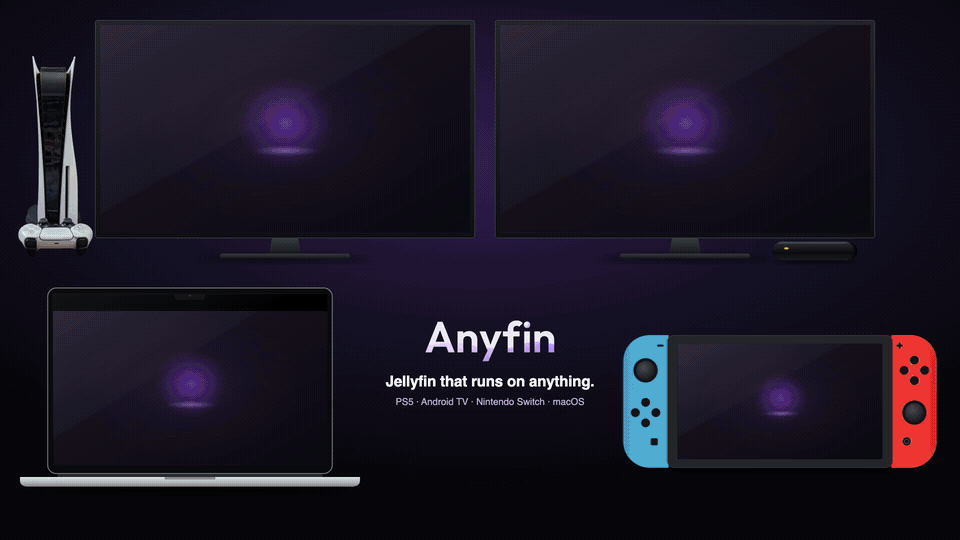

<p align="center">
  
</p>

<p align="center">
  <strong>Jellyfin that runs on anything.</strong><br>
  A Jellyfin client for the PS5, the Switch and Android TV, written in React and built with
  <a href="https://github.com/bartando/react-on-anything">React on Anything</a>: one app, drawn natively on every screen.
</p>

<p align="center">
  <a href="demo/demo.mp4"></a><br>
  <sub><a href="demo/demo.mp4">Full-quality video</a> · made with <a href="demo/">demo/</a></sub>
</p>

## Where it runs

| | |
|---|---|
| **Android TV** (NVIDIA Shield) | An APK. The remote's Menu key opens options; MediaCodec decodes the video. |
| **Nintendo Switch** | A homebrew NRO (Atmosphère). Docked with Joy-Con or handheld with touch, the hints named as the Switch names its buttons. |
| **PS5** | A homebrew title on a jailbroken console. |
| **macOS** | React on Anything's desktop preview, for working on it. |

## What it does

- Finds Jellyfin servers on the LAN, or takes an address typed on the on-screen keyboard.
  Signs in with a password or Quick Connect.
- Home with Continue Watching, Next Up, favorites and the latest movies and shows.
- Movie and TV libraries with an A-Z bar, search, title pages with seasons, cast, stills and
  "More like this", and person pages. A Trailer button beside Play when the server has a trailer.
- A full-screen player over Jellyfin's PlaybackInfo: subtitles (embedded or files),
  audio tracks, versions, Skip Intro and Recap, Up Next, and seeking on the triggers.
- Optional upscaling, with two upscalers side by side to compare.
- Triangle on a card opens a menu: play, mark watched, favorite, details.
  Options opens Settings anywhere and the player's panel during playback.

## Build

Anyfin is an external [React on Anything](https://github.com/bartando/react-on-anything) app. Clone
both side by side:

```sh
git clone https://github.com/bartando/react-on-anything.git
git clone https://github.com/bartando/anyfin.git
cd react-on-anything
```

Follow the react-on-anything README to install its tools, then:

```sh
npm run dev -- --app-dir ../anyfin                                  # native macOS preview, rebuilds on save
npm run build -- --app-dir ../anyfin                                # PS5 package in dist/PPSA99080/
.venv/bin/python3 tools/android.py --app-dir ../anyfin --device <adb serial>   # Android TV APK, installed
.venv/bin/python3 tools/switch.py --app-dir ../anyfin --send <console address> # Switch NRO, to the netloader
```

The Android and Switch hosts have their own notes:
[ANDROID.md](https://github.com/bartando/react-on-anything/blob/main/docs/ANDROID.md) and
[SWITCH.md](https://github.com/bartando/react-on-anything/blob/main/docs/SWITCH.md).

## License

GPL-3.0, the same as react-on-anything. See [LICENSE](LICENSE). The fonts are under the SIL Open
Font License and the sounds under CC BY 4.0 (`assets/sounds/NOTICE.txt`).
